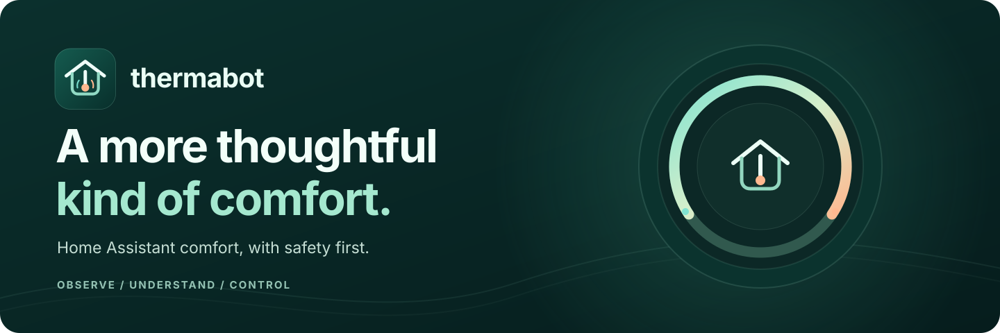

# thermabot

thermabot is a Home Assistant companion for comfort-focused HVAC automation. It combines
thermostat and sensor readings, household presence, schedules, and comfort bands to make
explainable recommendations and, when explicitly enabled, manage one configured thermostat.
The project is designed to fail closed: safety controls and operating mode take precedence
over convenience.

## Release status

| Channel | Version | Status |
|---|---|---|
| Stable | v0.6.7 | Historical release retained in the private archive; its history is not copied here |
| Prerelease | [v0.6.8-rc.4](CHANGELOG.md#068-rc4---2026-10-30-prerelease) | Current public source snapshot; not a stable release |

For privacy, this repository starts with one history-free source snapshot. Earlier private
release tags, GitHub discussions, and CI artifacts remain in the private archive and are not
mirrored. The v0.6.8 release candidate is not evidence that a live soak passed, and does not
authorize enabling thermostat control. See [CHANGELOG.md](CHANGELOG.md) for release notes and
[the v0.6.8 plan](docs/v0.6.8-plan.md) for the release gate and roadmap.

## Safety first

- A fresh installation starts in **SETUP NEEDED**. Without a configured thermostat, it does
  not read or write a climate entity.
- The kill switch is off and the run mode defaults to **SHADOW**. SHADOW simulates decisions
  and sends no thermostat writes.
- Thermostat commands pass through one controller path, safety guards, and an entity/service
  allowlist. The bot does not automatically resume control after a Home Assistant outage.
- The Home Assistant heartbeat-loss package is optional. It can disable the enable mirror and
  notify, but it never writes thermostat settings and cannot run while Home Assistant itself
  is unavailable.
- Keep the UI on a trusted LAN; do not port-forward it to the internet. Use a dedicated
  non-admin Home Assistant account when connecting with a token, and store credentials in
  the add-on secret options or an uncommitted `.env` file.

Read [SECURITY.md](SECURITY.md) and [CONTRIBUTING.md](CONTRIBUTING.md) before deploying or
contributing.

## Features

- Home Assistant setup wizard for thermostat, sensors, presence, comfort bands, and weather.
- Explainable schedule, comfort, and HVAC status pages with SHADOW-first control safeguards.
- Responsive desktop and mobile dashboard with operating version visible in the UI.
- Owner-only configuration export/import with validation and a verified pre-import backup.
- Owner-only SQLite backup download, recovery status, and offline restore guidance.
- HA outage visibility, stale-reading rejection, and an optional heartbeat-loss safety package.
- Daily read-only SHADOW report and per-minute state diagnostics for release-soak review.
- Read-only Home Assistant sun/location context, room-floor labels, and optional mapped
  exterior-door/garage SHADOW assessment.

Schedules, daily history, and local UI times currently use `America/New_York`. The time zone
shown from Home Assistant and the `TZ` environment variable do not yet change the scheduler.
UTC-based reports and API timestamps remain in UTC.

Live fan, blind, heater, solar-aware, floor/room, and external-door control, push notifications,
and full PWA/offline behavior remain roadmap work. See the
[v0.6.8 plan](docs/v0.6.8-plan.md); listed ideas do not imply support or automatic actuation.

## Installation

### Home Assistant add-on (preferred)

The Home Assistant add-on is the preferred installation path when using a stable add-on
release. It uses Supervisor's Home Assistant API access by default, so a separate long-lived
token is not required for the same Home Assistant instance.

1. In Home Assistant, open **Settings > Add-ons > Add-on Store**, open the menu, and add
   `https://github.com/comment23/thermabot` as an add-on repository.
2. Find **thermabot**, install it, and review its options. Leave the advanced `ha_url` and
   `ha_token` overrides blank to use Supervisor access for this Home Assistant instance.
3. Start the add-on and open thermabot from the Home Assistant sidebar using ingress.
4. Complete the in-app setup wizard. Keep the bot disabled and in SHADOW while reviewing its
   behavior.

The add-on currently supports **amd64**. The public source snapshot is a prerelease, not a
stable production release. The in-app version is the application version (`0.6.8`); the
Home Assistant add-on catalog marks this build as `0.6.8-rc.4`. See
[first-run setup](docs/setup.md) for the wizard and operating details.

### Docker Compose (fallback)

The Compose example builds the prerelease container from the checked-out source and does not
require access to a private GHCR image. Clone this public repository, copy `.env.example` to
`.env`, then set at least `HA_URL` and `HA_TOKEN` to a dedicated non-admin Home Assistant
user's credentials. Keep `.env` private and never commit it. Do not use this prerelease for a
production installation.

```shell
git clone https://github.com/comment23/thermabot.git
cd thermabot
docker compose -f deploy/docker-compose.yml up -d
```

The example persists the SQLite database and backups under `./data` and serves the UI on
port `8095`. Restrict access to your trusted LAN. For updates, check out an explicit release
tag, back up `data`, and retain the prior image/container settings for rollback.

The Compose file is an example, not a complete secrets-management or reverse-proxy setup.
Review its ports, volume, restart policy, and environment values for your host.

## First run and recovery

**New in v0.6.8-rc.2:** on an unclaimed installation, the browser offers **Create administrator**
for the initial Owner account; there are no default credentials. Claim it on a trusted LAN before exposing
the app to others. Creating the account signs you in and opens the setup wizard only if no
saved configuration exists. Existing installations retain their accounts and configuration
and skip first-run onboarding. See [first-run details](docs/setup.md).

**New in v0.6.8-rc.3:** the Owner setup wizard shows read-only Home Assistant location and sun
context, suggests fan/cover/heater/door entities, and lets the Owner label rooms by floor.
Owners can optionally map door/garage contacts for a read-only, time-thresholded SHADOW
assessment. Suggestions must be confirmed; this release does not actuate those devices or
change the comfort plan.

An unconfigured install shows **SETUP NEEDED**. Follow [docs/setup.md](docs/setup.md) to
connect to Home Assistant and configure the thermostat, sensors, presence, comfort bands,
and optional weather source. The setup wizard reads Home Assistant state but does not call
Home Assistant services.

Use **Controls** to inspect the current mode and safeguards. Do not switch to ACTIVE until
the release gate and your own review are complete. For v0.6.8, the gate requires seven
consecutive days in SHADOW with no sent thermostat writes, review of degraded intervals and
stale rooms, and an explicit owner go/no-go.

The recovery tools are Owner-only. Configuration exports omit environment credentials, but
database backups contain sensitive account/session data and household configuration. Store
them encrypted and off-device. Back up Home Assistant configuration and environment
secrets separately; a thermabot database backup does not include them. Review the recovery
screen and test the documented offline restore procedure before relying on backups.

## Documentation

- [First-run setup and Settings](docs/setup.md)
- [v0.6.8 release gate and roadmap](docs/v0.6.8-plan.md)
- [Weather providers](docs/weather.md)
- [Efficiency model](docs/efficiency.md)
- [Security policy](SECURITY.md)
- [Contributor and release process](CONTRIBUTING.md)
- [Published changelog](CHANGELOG.md)
- [GitHub social-preview artwork](docs/branding/social-preview.png)

The add-on icons and social preview are generated from the SVG artwork with
`python scripts/_gen_addon_art.py` using the development dependencies and Playwright Chromium.

## Development and QA

Python 3.12 is required. Create a virtual environment, install the locked dependencies, then
run the same checks used by CI:

```shell
python -m venv .venv
# Activate the virtual environment for your shell.
pip install --require-hashes -r requirements.lock
playwright install chromium
ruff check .
ruff format --check .
mypy --strict thermabot/core
python -m pytest tests/unit tests/integration -q
python -m pytest tests/e2e -q
```

The E2E suite uses a generic test Home Assistant fixture, not a real thermostat. Automated
tests are not a substitute for the documented SHADOW soak or owner review.

## License

See [LICENSE](LICENSE).
